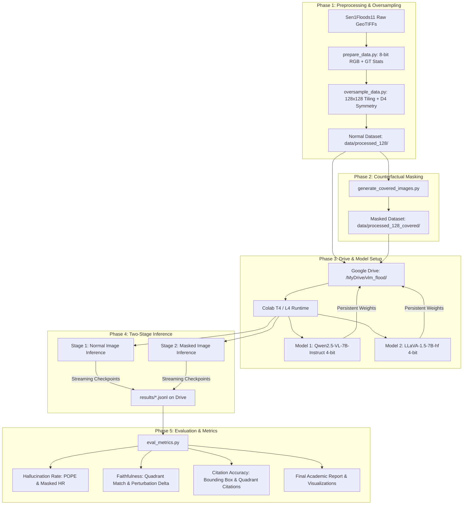

# 🌊 Implementation Plan: VLM Flood Detection, Hallucination & Faithfulness Benchmark

## 📌 Project Overview
This project evaluates the visual grounding, hallucination tendencies, and citation faithfulness of two leading open-weights Vision-Language Models (VLMs) on satellite optical imagery (**Sen1Floods11** dataset).

The project answers three central research questions:
1. **Detection Capability:** Can standard VLMs reliably identify, locate, and quantify surface water inundation under varying cloud and terrain conditions?
2. **Contextual Hallucination:** When floodwater is artificially camouflaged/masked with dry terrain, does the model still predict flood based purely on contextual visual priors (e.g., river meanders, valleys, lush vegetation)?
3. **Faithfulness & Citations:** Are the model's textual reports and spatial citations (quadrants and bounding boxes) faithful to actual ground truth water masks?

---

## 🏗️ Architecture & Data Flow



---

## 🗓️ Project Phases Breakdown

---

### 🔹 Phase 1: Data Preprocessing, Augmentation & Oversampling
**Goal:** Expand the dataset from 446 hand-labeled chips to a balanced, high-variance dataset without introducing synthetic spatial distortion.

#### 1.1 Physical Rationale for Satellite Augmentation
Unlike natural perspective photos (which have an upright gravitational orientation), satellite optical imagery is nadir (downward-looking). Therefore, images exhibit complete **$D_4$ Dihedral Group symmetry** (rotation and reflection invariance).

#### 1.2 Two Complementary Expansion Strategies
1. **Spatial Tiling to $128 \times 128$ ($16\times$ sample multiplier):**
   * Divide each $512 \times 512$ Sentinel-2 chip and its ground truth mask into sixteen $128 \times 128$ non-overlapping sub-chips ($4 \times 4$ grid):
     * Tile indexing: `chip_id_r{0..3}_c{0..3}` with bounding box coordinates `[ymin, xmin, ymax, xmax]`.
   * Recompute exact `water_fraction`, `nodata_fraction`, and `dominant_quadrant` for every $128 \times 128$ sub-chip.
   * *Benefit:* Transforms 446 chips into **7,136 images of size $128 \times 128$**, preserving native 10m Sentinel-2 resolution without interpolation artifacts, and isolating localized flood pockets from dry terrain.
2. **Dihedral Augmentation ($D_4$ transforms):**
   * Horizontal flip, vertical flip, and $90^\circ, 180^\circ, 270^\circ$ rotations.
   * Applied selectively to balance underrepresented flood severity tiers.

#### 1.3 Stratified Class Balancing & Filtering
* **Nodata Filtering:** Flags or excludes tiles with $>50\%$ sensor nodata / black border artifacts (`is_mostly_cloud = True`), leaving high-quality informative tiles.
* Group tiles into 3 distinct evaluation tiers:
  * **Tier 0: Negative Controls (Dry Land / No Flood):** $\text{water\_fraction} = 0.0$ (Crucial for measuring false alarms and hallucinations).
  * **Tier 1: Moderate Inundation:** $0.001 \le \text{water\_fraction} \le 0.15$.
  * **Tier 2: Severe Flooding:** $\text{water\_fraction} > 0.15$.

#### 1.4 Deliverables & Scripts
* `oversample_data.py`: Generates the $128 \times 128$ tiled and augmented images and creates `data/processed_128/metadata.json`.

---

### 🔹 Phase 2: Counterfactual Perturbation (Masking / Camouflage)
**Goal:** Create a controlled counterfactual baseline where visible water is replaced by realistic dry land terrain to test contextual hallucination.

#### 2.1 The Camouflage Mechanism
* For every image in the augmented dataset containing water pixels (`mask == 1`):
  * Sample dry land pixels (`mask == 0`) from the same scene.
  * Inpaint the sampled dry pixels over the water pixels.
  * If the entire chip is water/cloud, fill with median dry terrain reflectance.
* **Why this is superior to black masks:** VLMs are trained on natural photography and often react to black bounding boxes as missing data or censorship. Inpainting with dry land preserves natural scene semantics while eliminating the visual evidence of water.

#### 2.2 Expected Ground Truth
* **Stage 1 (Normal):** Water is present (`flood_present = True` for non-dry chips).
* **Stage 2 (Masked):** Water is completely absent (`flood_present = False` for all chips).
* *Any prediction of flood on a masked image is a definitive, verifiable hallucination.*

#### 2.3 Deliverables & Scripts
* `generate_covered_images.py`: Extended to read `metadata_augmented.json` and save camouflaged images to `data/processed_augmented_covered/`.

---

### 🔹 Phase 3: Model Selection & Cloud GPU Storage Architecture
**Goal:** Configure high-performance, low-cost model execution using Google Drive and free/low-cost Google Colab GPUs (T4 / L4).

#### 3.1 Model Selection & Rationale
We evaluate two complementary, open-weights Vision-Language Models:

| Parameter | **Model 1: Qwen2.5-VL-7B-Instruct** | **Model 2: LLaVA-1.5-7B-hf** |
| :--- | :--- | :--- |
| **Developer** | Alibaba Cloud (Qwen Team) | Haotian Liu et al. (UW-Madison, MSFT) |
| **Architecture** | Native dynamic resolution, Qwen-2.5 LLM backbone | CLIP ViT-L/14 + Vicuna-1.5 LLM backbone |
| **Spatial Grounding** | Native support for coordinates `[ymin, xmin, ymax, xmax]` | Textual descriptions / quadrant references |
| **Academic Role** | State-of-the-art VLM baseline for spatial reasoning | The canonical baseline used in the original POPE hallucination paper |
| **Quantized VRAM** | ~5.2 GB (4-bit NF4) | ~4.8 GB (4-bit NF4) |

#### 3.2 Persistent Google Drive Cache Architecture
Downloading 15 GB model weights repeatedly on Colab takes 20+ minutes and risks session disconnections. We route the Hugging Face cache and dataset storage directly to Google Drive:

```python
# Colab setup snippet
from google.colab import drive
import os

drive.mount('/content/drive')

DRIVE_ROOT = "/content/drive/MyDrive/vlm_flood_research"
os.environ["HF_HOME"] = f"{DRIVE_ROOT}/hf_cache"      # Saves model weights permanently on Drive
DATA_DIR = f"{DRIVE_ROOT}/data"
RESULTS_DIR = f"{DRIVE_ROOT}/results"
```

#### 3.3 4-Bit NormalFloat (NF4) Quantization
Both 7B models are loaded with `bitsandbytes` 4-bit quantization:
```python
from transformers import BitsAndBytesConfig
import torch

quant_config = BitsAndBytesConfig(
    load_in_4bit=True,
    bnb_4bit_quant_type="nf4",
    bnb_4bit_compute_dtype=torch.float16,
    bnb_4bit_use_double_quant=True
)
```

#### 3.4 Resumable Streaming Inference Checkpoints
Inference writes results line-by-line into JSON Lines (`.jsonl`) files directly on Google Drive. If Colab disconnects, execution resumes from the exact image where it stopped.

#### 3.5 Deliverables & Scripts
* `vlm_benchmark_colab.ipynb`: Complete, turnkey Google Colab notebook integrating Drive mounting, model switching (Qwen vs. LLaVA), and batch inference.

---

### 🔹 Phase 4: Two-Stage Model Inference Execution
**Goal:** Query both models across all chips using standardized prompt styles.

#### 4.1 Prompting Strategies
Every image chip is evaluated with three prompt types:
1. **POPE Binary Style (Strict Yes/No):**
   > *"Is there surface water or flood inundation present in this satellite image? Answer only Yes or No."*
2. **Structured JSON (Quantification & Spatial Citation):**
   > *"Analyze this satellite image for surface water/flooding. Return a JSON object with: 'flood_present' (boolean), 'water_percentage' (float 0-100), 'dominant_quadrant' (string: 'top-left', 'top-right', 'bottom-left', 'bottom-right', or 'none'), and 'cited_regions' (list of bounding boxes or landmarks)."*
3. **Free Text Report (Open-Ended Visual Grounding):**
   > *"Provide a detailed technical damage assessment describing visible inundation, affected areas, and confidence level."*

#### 4.2 Execution Matrix

| Stage | Image Set | Models | Prompts Evaluated |
| :--- | :--- | :--- | :--- |
| **Stage 1 (Normal)** | `processed_128/` | Qwen 2.5 VL & LLaVA 1.5 | POPE, Structured JSON |
| **Stage 2 (Masked)** | `processed_128_covered/`| Qwen 2.5 VL & LLaVA 1.5 | POPE, Structured JSON |

---

### 🔹 Phase 5: Evaluation Engine & Formal Metrics
**Goal:** Compute standard academic metrics comparing Qwen2.5-VL and LLaVA-1.5 across both normal and masked conditions.

#### 5.1 Hallucination Rate (HR)
1. **POPE Benchmark Metrics on Normal Dataset:**
   * **Accuracy:** $(TP + TN) / (TP + TN + FP + FN)$
   * **Precision:** $TP / (TP + FP)$
   * **Recall:** $TP / (TP + FN)$
   * **F1 Score:** $2 \cdot P \cdot R / (P + R)$
   * **POPE Hallucination Rate (False Alarm on Dry Land):**
     $$\text{HR}_{\text{POPE}} = \frac{FP}{FP + TN}$$
2. **Counterfactual Masked Hallucination Rate:**
   $$\text{HR}_{\text{masked}} = \frac{\sum_{i=1}^{N_{\text{masked}}} \mathbb{I}(\text{Model Predicts Flood} \mid \text{Masked Image } i)}{N_{\text{masked}}}$$
   *(Measures frequency of hallucinations triggered strictly by surrounding landscape priors).*

#### 5.2 Faithfulness Metrics
1. **Spatial Quadrant Match Rate:**
   $$\text{Faithfulness}_{\text{quad}} = \frac{\text{Correctly Cited Quadrants on True Positives}}{\text{Total True Positives}}$$
2. **Quantitative Estimation Error (MAE):**
   $$\text{MAE}_{\text{water}} = \frac{1}{N} \sum_{i=1}^N \left| \text{Predicted Water \%} - \text{GT Water \%} \right|$$
3. **Counterfactual Perturbation Delta ($\Delta_{\text{pert}}$):**
   Measures whether the model's confidence or prediction correctly drops when flood evidence is removed:
   $$\Delta_{\text{pert}} = \text{Accuracy}_{\text{normal}} - \text{Accuracy}_{\text{masked}}$$

#### 5.3 Correct Citations
1. **Bounding Box Citation IoU (for Qwen2.5-VL):**
   Intersection over Union between model-cited bounding boxes and ground truth water mask contours:
   $$\text{IoU} = \frac{\text{Area}(\text{BBox}_{\text{pred}} \cap \text{BBox}_{\text{GT}})}{\text{Area}(\text{BBox}_{\text{pred}} \cup \text{BBox}_{\text{GT}})}$$
   *Correct Citation:* $\text{IoU} \ge 0.3$.
2. **Quadrant Citation Precision:**
   Fraction of valid water pixels located inside the model's cited quadrant.

#### 5.4 Deliverables & Scripts
* `eval_metrics.py`: Parses `.jsonl` predictions from both models, calculates all formulas above, and outputs comparative CSV and markdown tables.

---

### 🔹 Phase 6: Visualization, Comparative Analysis & Final Report
**Goal:** Synthesize results into publication-ready charts and documentation.

#### 6.1 Artifacts to Generate
* `results/figures/model_comparison_radar.png`: Multi-axis comparison of Accuracy, Recall, F1, Hallucination Rate, and Faithfulness.
* `results/figures/normal_vs_masked_bar.png`: Detection rates before vs. after masking for both models.
* `results/figures/water_percentage_scatter.png`: Ground truth vs. predicted water fraction regression plot.
* `results/figures/qualitative_samples.png`: Side-by-side visualization of Normal image, Masked image, Ground Truth mask, and Model text outputs with citations.
* `results/FINAL_REPORT.md`: Comprehensive academic synthesis answering all three research questions.

---

## 🗂️ Target Repository Structure

```text
vlm_research/
├── config.py                              # Central paths, seed, and constants
├── data.py                                # GeoTIFF loader & 8-bit contrast stretcher
├── prepare_data.py                        # Baseline 512x512 processing
├── oversample_data.py                     # [Phase 1] 128x128 spatial tiling & D4 augmentation
├── generate_covered_images.py             # [Phase 2] Dry-land camouflage inpainting
├── vlm_benchmark_colab.ipynb              # [Phase 3 & 4] Colab notebook with Drive integration
├── eval_metrics.py                        # [Phase 5] Hallucination, Faithfulness & Citation scorer
├── data/
│   ├── raw/sen1floods11_v1.1/             # Original Sentinel-2 GeoTIFFs & masks
│   ├── processed/                         # Baseline 446 RGB PNGs (512x512)
│   ├── processed_covered/                 # Baseline 446 Camouflaged PNGs (512x512)
│   ├── processed_128/                     # [Phase 1] 128x128 tiled & augmented RGB PNGs
│   └── processed_128_covered/             # [Phase 2] 128x128 Camouflaged PNGs
├── results/
│   ├── figures/                           # Visualizations, scatterplots & charts
│   ├── qwen_stage1_normal.jsonl           # Qwen predictions on normal images
│   ├── qwen_stage2_masked.jsonl           # Qwen predictions on masked images
│   ├── llava_stage1_normal.jsonl          # LLaVA predictions on normal images
│   ├── llava_stage2_masked.jsonl          # LLaVA predictions on masked images
│   ├── metrics_summary.json               # Aggregated numerical scores
│   └── FINAL_REPORT.md                    # Complete research findings
├── IMPLEMENTATION.md                      # This roadmap
├── PROGRESS_REPORT.md                     # Work log
└── README.md                              # Main documentation
```

---

## 🚀 Step-by-Step Execution Checklist

| Step | Action | Script / Command | Expected Output |
| :---: | :--- | :--- | :--- |
| **1** | Run baseline preprocessing | `python prepare_data.py` | `data/processed/` (446 PNGs + metadata.json) |
| **2** | Run baseline camouflaging | `python generate_covered_images.py` | `data/processed_covered/` (446 PNGs) |
| **3** | Run 128x128 tiling & oversampling | `python oversample_data.py` | `data/processed_128/` (128x128 PNGs + metadata.json) |
| **4** | Generate camouflaged 128x128 set | `python generate_covered_images.py --dataset 128` | `data/processed_128_covered/` (128x128 PNGs) |
| **5** | Zip & sync data to Google Drive | Upload to `MyDrive/vlm_flood/data/` | Data accessible in Colab |
| **6** | Execute Stage 1 (Normal) on Colab | Run cells in `vlm_benchmark_colab.ipynb` | `qwen_stage1_normal.jsonl`, `llava_stage1_normal.jsonl` |
| **7** | Execute Stage 2 (Masked) on Colab | Run cells in `vlm_benchmark_colab.ipynb` | `qwen_stage2_masked.jsonl`, `llava_stage2_masked.jsonl` |
| **8** | Evaluate metrics & generate charts | `python eval_metrics.py` | `metrics_summary.json` & comparison figures |
| **9** | Compile final report | Auto-generated in `results/FINAL_REPORT.md` | Complete presentation of findings |
